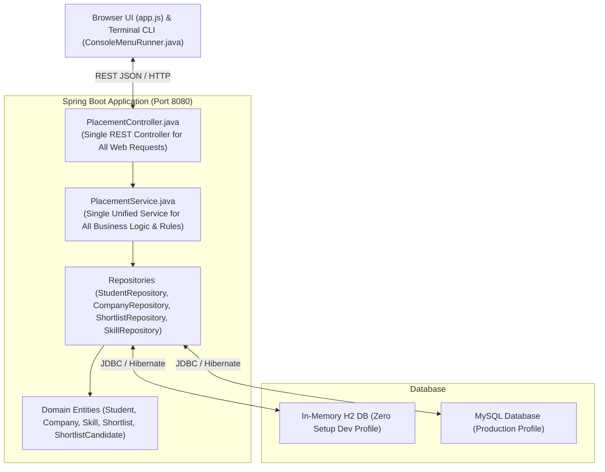
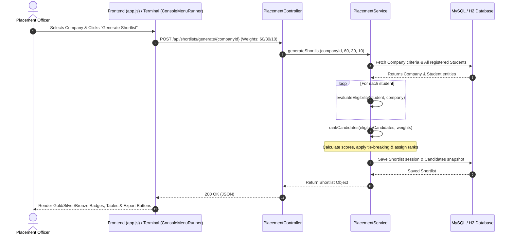
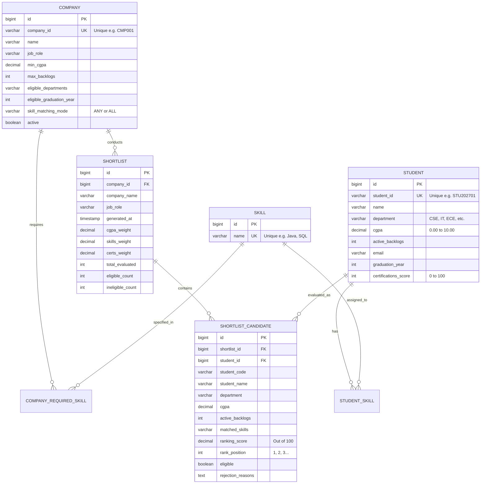

# 🎓 Campus Placement Drive Candidate Tracking & Shortlisting Portal

<p align="center">
  
  
  
  
  
  
  
</p>

<p align="center">
  A full-stack, beginner-friendly web application designed for a University <b>Training and Placement (T&P) Cell</b> to automate student academic tracking, recruitment eligibility rule configuration, multi-criteria filtering, weighted candidate ranking, and instant CSV/JSON report exporting.
</p>

---

## 📌 Quick Access Link

When running locally, access the live portal directly in your browser:
👉 **[http://localhost:8080](http://localhost:8080)** *(No login credentials required — direct access to all modules)*

---

## 📑 Table of Contents

- [Problem Statement & Solution](#-problem-statement--solution)
- [System Architecture](#-system-architecture)
- [Core Application Modules](#-core-application-modules)
- [Object-Oriented Programming (OOP) Concepts](#-object-oriented-programming-oop-concepts)
- [Database Design (ER Diagram)](#-database-design-er-diagram)
- [Candidate Ranking Formula](#-candidate-ranking-formula)
- [Prerequisites & Technology Stack](#-prerequisites--technology-stack)
- [How to Run Locally](#-how-to-run-locally)
  - [Method 1: Instant Demo Mode (Zero Setup H2 Profile)](#method-1-instant-demo-mode-zero-setup-h2-profile)
  - [Method 2: MySQL Production Mode](#method-2-mysql-production-mode)
  - [Method 3: Running in IDE (VS Code / IntelliJ IDEA)](#method-3-running-in-ide-vs-code--intellij-idea)
- [REST API Reference](#-rest-api-reference)
- [CSV Import Format](#-csv-import-format)
- [Testing & Quality Assurance](#-testing--quality-assurance)
- [College Viva & Presentation Q&A](#-college-viva--presentation-qa)
- [License](#-license)

---

## 💡 Problem Statement & Solution

### The Challenge
University placement offices manually process thousands of student spreadsheets against varied company eligibility criteria (different minimum CGPAs, backlog tolerances, skill requirements, and branch restrictions). This manual process is:
- **Error-prone**: Overlooking backlogs or missing skills leads to student disqualification during campus drives.
- **Time-consuming**: Placement coordinators spend hours cross-referencing criteria.
- **Lacks Transparency**: Students are often left confused regarding why they were not shortlisted.

### The Solution
The **Campus Placement Drive Portal** automates the entire recruitment workflow:
1. Maintains a centralized database of student academic records and technical skills.
2. Allows placement coordinators to dynamically configure recruitment rules for visiting companies without changing any code.
3. Automatically evaluates all candidates through an explainable **Eligibility Rule Engine**, providing exact human-readable rejection reasons for ineligible candidates.
4. Generates an objective, transparent **Weighted Composite Ranking** for all qualified candidates with automatic CGPA tie-breaking.
5. Exports shortlists to RFC 4180 compliant CSV and structured JSON files with a single click.

---

## 🏗 System Architecture

The project adheres to a clean, beginner-friendly **Model-View-Controller (MVC)** architectural pattern:



### Complete End-to-End Shortlisting Flow



---

## 📦 Core Application Modules

### 1. Student Management Module
- **Add / Edit / Delete**: Manage complete student profiles with modal confirmations.
- **Data Validation**:
  - Unique Student ID validation.
  - CGPA restricted strictly between `0.0` and `10.0`.
  - Active backlogs cannot be negative (`>= 0`).
  - Standard RFC email format check.
- **Skills Tagging**: Associate multiple technical skills (`Java`, `Python`, `SQL`, `Spring Boot`, etc.) per student.
- **Bulk CSV Import**: Import entire batches of students using pre-formatted CSV files.
- **Search & Filter**: Live client-side search by Student ID/Name and dropdown filter by Department (`CSE`, `IT`, `ECE`, `MECH`, `CIVIL`).

### 2. Visiting Company Management Module
- **Recruitment Configuration**: Set job role, package, minimum CGPA, maximum allowable backlogs, eligible departments, and graduation year.
- **Dynamic Skill Criteria**: Define required technical skills and choose matching mode:
  - **`ANY` Mode**: Student qualifies if they possess at least one required skill.
  - **`ALL` Mode**: Student must possess all specified required skills.
- **Live Readiness Indicator**: The company list calculates and displays the count of eligible registered candidates in real time.

### 3. Eligibility Rule Engine Module
- Evaluates registered students against all active company requirements.
- Strictly segregates students into **Eligible** and **Ineligible** pools.
- Generates clear, human-readable rejection reasons:
  - *"CGPA (7.20) is below required minimum (7.50)"*
  - *"Active backlogs (1) exceed permitted limit (0)"*
  - *"Department 'MECH' is not eligible for this drive"*
  - *"Graduation year (2025) does not match required year (2027)"*
  - *"Missing required skills: [Java, SQL]"*

### 4. Candidate Ranking Engine Module
- Computes an objective composite score out of 100 based on configurable weights:
  - **CGPA Weight**: Default `60%`
  - **Skills Match Weight**: Default `30%`
  - **Certifications / Achievements Weight**: Default `10%`
- **Secondary Tie-Breaking**: When two candidates achieve the exact same composite score, the student with the higher CGPA is awarded the higher rank.

### 5. Shortlist Generation & Export Module
- One-click shortlist generation for any registered company.
- Separate tabs for viewing **Ranked Eligible Candidates** and **Ineligible Candidates (with rejection reasons)**.
- **RFC 4180 CSV Export**: Cleanly formatted CSV export (`[CompanyName]_shortlist.csv`) with proper quote escaping.
- **JSON Export**: Formatted JSON data file (`[CompanyName]_shortlist.json`) downloadable directly from browser.
- **Shortlist History**: Stores historical generation rounds in the database so past drives can be reviewed anytime.

### 6. Dashboard & Analytics Module
- High-level metric summary cards: Total Students, Total Companies, Latest Shortlist Generated, and Eligible Candidates Pool.
- **Visual Analytics**: Interactive Chart.js doughnut chart illustrating student distribution across departments.
- Recent shortlist generation audit table.

---

## 🧩 Object-Oriented Programming (OOP) Concepts

This project was built to illustrate real-world application of core Object-Oriented Programming principles:

| OOP Principle | Implementation in Project | Example Reference |
| :--- | :--- | :--- |
| **Encapsulation** | All entity fields are kept `private` and accessed via public getter and setter methods. Internal state validation is maintained within entities and services. | [`Student.java`](src/main/java/com/placement/model/Student.java), [`Company.java`](src/main/java/com/placement/model/Company.java) |
| **Abstraction** | Business logic is abstracted behind service interfaces. Controllers handle HTTP routing without knowing database mechanics, while services interact with high-level repositories. | [`EligibilityService.java`](src/main/java/com/placement/service/EligibilityService.java), [`StudentController.java`](src/main/java/com/placement/controller/StudentController.java) |
| **Inheritance** | Spring Data JPA repositories extend `JpaRepository<T, ID>`, inheriting all standard CRUD operations and query creation methods. | [`StudentRepository.java`](src/main/java/com/placement/repository/StudentRepository.java) |
| **Polymorphism** | Uses dynamic method dispatching, interface-based dependency injection, and custom `Comparator` implementations to sort candidates dynamically based on multiple criteria. | [`RankingService.java`](src/main/java/com/placement/service/RankingService.java) |

---

## 🗄 Database Design (ER Diagram)



---

## 📊 Candidate Ranking Formula

Each component is normalized to a percentage score out of 100 before applying user-configured weights (default: **60% CGPA**, **30% Skills**, **10% Certifications**):

1. **Normalized CGPA**:
   $$\text{Normalized CGPA} = \left(\frac{\text{Student CGPA}}{10.0}\right) \times 100.0$$

2. **Technical Skills Match Score**:
   $$\text{Skill Match Score} = \left(\frac{\text{Count of Matched Skills}}{\text{Total Required Skills}}\right) \times 100.0$$

3. **Composite Ranking Score**:
   $$\text{Total Score} = (\text{Normalized CGPA} \times W_{\text{cgpa}}) + (\text{Skill Match Score} \times W_{\text{skills}}) + (\text{Certifications Score} \times W_{\text{certs}})$$

4. **Tie-Breaking Rule**:
   $$\text{If } \text{Total Score}_A == \text{Total Score}_B \implies \text{Sort by } \text{CGPA}_A > \text{CGPA}_B$$

---

## 🛠 Prerequisites & Technology Stack

### System Prerequisites
- **Java Development Kit (JDK)**: Java 17 or Java 21 installed.
- **Apache Maven**: Version 3.8+ (or use IDE built-in Maven).
- **Web Browser**: Chrome, Edge, Firefox, or Safari.
- **(Optional) MySQL Server**: Version 8.0+ *(only required if not using the zero-setup H2 profile)*.

---

## 🚀 How to Run Locally

### ⚡ Quickest Way (One-Click Launcher)

Run either launcher script from the project folder:

```powershell
# In PowerShell / Windows Terminal:
.\run.ps1

# In Windows Command Prompt (CMD) or Double-Click in File Explorer:
run.bat
```

This launches the **Interactive Terminal Console** in your terminal and starts the **Web Portal** at [http://localhost:8080](http://localhost:8080) simultaneously!

---

### 🖥️ Interactive Terminal Console Mode

The application includes a command-line interface (CLI) that runs concurrently with the web server. You can manage students, register visiting companies, configure weights, and run the shortlisting engine directly from your terminal.

```
============================================================================
   CAMPUS PLACEMENT SHORTLISTING SYSTEM - INTERACTIVE TERMINAL CONSOLE
   (Web Portal running simultaneously at http://localhost:8080)
============================================================================

--------------------------------------------------------------
 [1] Add New Student
 [2] View All Registered Students
 [3] Add New Visiting Company
 [4] View All Visiting Companies
 [5] Run Shortlisting & Ranking Engine
 [6] View Historical Shortlists
 [7] View Placement Analytics Summary
 [8] Exit & Shutdown Application
--------------------------------------------------------------
Enter choice [1-8]: 
```

#### Terminal Menu Options:
1. **`[1] Add New Student`**: Prompts step-by-step for Student ID, Full Name, Department, CGPA, Backlogs, Email, Batch Year, Skills (comma-separated), and Certifications Score.
2. **`[2] View All Registered Students`**: Renders an ASCII table showing IDs, Names, Departments, CGPA, Backlogs, Batches, and Skills.
3. **`[3] Add New Visiting Company`**: Prompts for Company Code, Name, Job Role, Min CGPA Cutoff, Max Backlogs, Skill Mode (`ALL` vs `ANY`), Required Skills, and Eligible Departments.
4. **`[4] View All Visiting Companies`**: Displays a formatted directory table of all registered hiring companies and their criteria.
5. **`[5] Run Shortlisting & Ranking Engine`**:
   - Lists registered companies to pick from.
   - Allows choosing default weights (60% CGPA, 30% Skills, 10% Certifications) or entering custom percentage weights.
   - Outputs ranked qualified candidates with `#1 [1st]`, `#2 [2nd]`, `#3 [3rd]` badges and composite scores out of 100.
   - Displays ineligible candidates with exact human-readable rejection reasons (e.g., *"CGPA below cutoff"*, *"Missing required skills: [Java, SQL]"*).
   - Automatically saves the session snapshot to database history.
6. **`[6] View Historical Shortlists`**: View previous shortlisting runs, evaluated counts, and weight configurations.
7. **`[7] View Placement Analytics Summary`**: Quick high-level summary of total students, active companies, and drives run.
8. **`[8] Exit & Shutdown Application`**: Cleanly shuts down the console and server process.

> **💡 Real-Time Synchronization**: The terminal CLI and web UI share the exact same underlying database. Any student or company added via the terminal appears instantly in the browser at `http://localhost:8080`, and vice versa!

---

### 🌐 Manual Launch Options

#### Method 1: Pre-Built JAR (Recommended)
```powershell
java -jar target/placement-portal-1.0.0.jar --spring.profiles.active=dev
```

#### Method 2: Maven Run
```powershell
mvn spring-boot:run -D"spring-boot.run.profiles=dev"
```

Once running, access the web portal at:
👉 **[http://localhost:8080](http://localhost:8080)** *(No login required)*

---

### 🐬 MySQL Production Mode (Optional)

By default, the application runs on an in-memory zero-setup H2 database (`dev` profile). If you wish to persist data in MySQL:

#### Step 1: Create Database
```sql
CREATE DATABASE IF NOT EXISTS placement_db CHARACTER SET utf8mb4 COLLATE utf8mb4_unicode_ci;
```

#### Step 2: Configure Credentials in `application.properties`
```properties
spring.datasource.url=jdbc:mysql://localhost:3306/placement_db?createDatabaseIfNotExist=true&useSSL=false&allowPublicKeyRetrieval=true&serverTimezone=UTC
spring.datasource.username=root
spring.datasource.password=your_mysql_password
```

#### Step 3: Run with Production Profile
```powershell
mvn spring-boot:run
```

---

### Method 3: Running in IDE (VS Code / IntelliJ IDEA)

- **IntelliJ IDEA**:
  1. Open the project folder in IntelliJ IDEA.
  2. Let Maven sync dependencies.
  3. Navigate to `src/main/java/com/placement/PlacementPortalApplication.java`.
  4. Click the green **Run** triangle icon next to the `main` method.
  5. Open `http://localhost:8080` in your browser.

- **Visual Studio Code**:
  1. Open the `OOPS_Project` directory in VS Code.
  2. Ensure the **Extension Pack for Java** is installed.
  3. Open `PlacementPortalApplication.java` and click **Run** above `public static void main`.
  4. Open `http://localhost:8080` in your browser.

---

## 🌐 REST API Reference

| Module | Method | Endpoint | Description |
| :--- | :--- | :--- | :--- |
| **Students** | `GET` | `/api/students` | Retrieve all registered students |
| **Students** | `POST` | `/api/students` | Register a new student |
| **Students** | `PUT` | `/api/students/{id}` | Update existing student record |
| **Students** | `DELETE` | `/api/students/{id}` | Delete student record |
| **Students** | `POST` | `/api/students/import-csv` | Bulk import students from multipart CSV file |
| **Companies** | `GET` | `/api/companies` | List all companies with eligible candidate count |
| **Companies** | `POST` | `/api/companies` | Register a new visiting company |
| **Companies** | `PUT` | `/api/companies/{id}` | Update company eligibility criteria |
| **Companies** | `DELETE` | `/api/companies/{id}` | Delete company record |
| **Shortlists**| `POST` | `/api/shortlists/generate/{companyId}` | Run evaluation and generate ranked shortlist |
| **Shortlists**| `GET` | `/api/shortlists` | View history of all generated shortlists |
| **Shortlists**| `GET` | `/api/shortlists/{id}` | Retrieve details of a specific historical shortlist |
| **Shortlists**| `GET` | `/api/shortlists/{id}/export-csv` | Download RFC 4180 formatted CSV export |
| **Shortlists**| `GET` | `/api/shortlists/{id}/export-json` | Download structured JSON export |
| **Dashboard** | `GET` | `/api/dashboard/stats` | Fetch real-time placement KPI metrics |

---

## 📄 CSV Import Format

To bulk import students, prepare a CSV file adhering to the structure below (a working [`sample_students.csv`](sample_students.csv) is included in the project root):

```csv
studentId,name,department,cgpa,activeBacklogs,email,graduationYear,skills
STU202711,Ananya Rao,CSE,8.95,0,ananya.rao@college.edu,2027,"Java, Spring Boot, MySQL"
STU202712,Vikram Malhotra,IT,7.80,0,vikram.m@college.edu,2027,"Python, Django, PostgreSQL"
STU202713,Kavita Nair,ECE,6.90,1,kavita.n@college.edu,2027,"C++, Embedded Systems"
```

---

## 🧪 Testing & Quality Assurance

The application contains **14 comprehensive JUnit 5 unit tests** verifying all business rules and edge cases:

```powershell
mvn test
```

### Test Case Coverage Matrix:
- ✅ **Test 1:** Candidate satisfying all conditions is accepted into eligible pool.
- ✅ **Test 2:** Candidate with CGPA below minimum threshold is rejected with proper reason.
- ✅ **Test 3:** Candidate with active backlogs exceeding threshold is rejected.
- ✅ **Test 4:** Candidate missing required technical skills is rejected.
- ✅ **Test 5:** Candidate from an unlisted department is rejected.
- ✅ **Test 6:** Candidate with graduation year mismatch is rejected.
- ✅ **Test 7:** `ANY` skill matching mode works correctly when candidate has subset of skills.
- ✅ **Test 8:** `ALL` skill matching mode correctly validates candidate has every required skill.
- ✅ **Test 9:** Boundary case: Candidate whose CGPA exactly equals threshold is accepted.
- ✅ **Test 10:** Ranking tie-breaker: Identical composite scores break ties via higher CGPA.
- ✅ **Test 11:** Zero-eligible candidate handling for high-threshold criteria.
- ✅ **Test 12:** Empty database candidate handling without throwing exceptions.
- ✅ **Test 13:** Input boundary validation (negative backlogs & CGPA out of range).
- ✅ **Test 14:** CSV RFC 4180 escaping verification and JSON structure validation.

---

## 🎓 College Viva & Presentation Q&A

### Q1: Why did you choose Spring Data JPA instead of plain JDBC?
> **Answer:** Spring Data JPA reduces boilerplate SQL code by mapping Java objects directly to database tables (ORM). It provides built-in CRUD operations through `JpaRepository` and automatically handles connection pooling through HikariCP.

### Q2: How does the application handle skill matching for companies?
> **Answer:** Companies configure a `SkillMatchingMode` enum:
> - In **`ALL` mode**, the algorithm checks that every single required skill is contained within the student's skills set.
> - In **`ANY` mode**, the algorithm checks if there is any non-empty intersection between the student's skills and the company's required skills.

### Q3: How do you prevent SQL injection and CSV injection?
> **Answer:** 
> - **SQL Injection**: Prevented because Spring Data JPA uses parameterized prepared statements under the hood.
> - **CSV Injection & Delimiter Issues**: Handled using `Apache Commons CSV` printer (`CSVFormat.DEFAULT`), which properly quotes and escapes commas, quotes, and newline characters per RFC 4180.

### Q4: How is candidate ranking made explainable and fair?
> **Answer:** Each candidate's score is calculated via an explicit mathematical formula where all metrics (CGPA, skills match percentage, and certifications) are normalized to a score out of 100 before applying user-configured weights that strictly total 100%. If scores tie, the higher CGPA is prioritized.

---

## 📜 License

This project is licensed under the [MIT License](LICENSE). You are free to use, modify, and distribute it for academic and educational projects.
